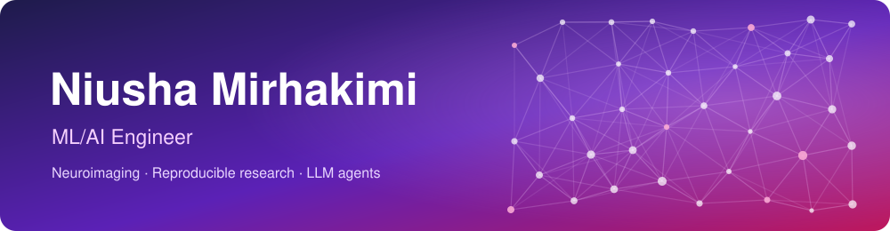
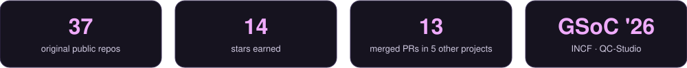

  

  I build AI systems that are grounded, testable and safe to rely on: a quality-control tool for brain MRI, 
  a RAG pipeline that cites its sources, an agent that can't make up a number.

  
  
  

  

## About me

- 🔬 First author of [*Numerical Uncertainty in Linear Registration: An Experimental Study*](https://arxiv.org/abs/2508.00781), on how floating-point noise changes the results of MRI registration tools
- 🧠 Google Summer of Code 2026 with [INCF](https://www.incf.org/), building [QC-Studio](https://github.com/nipoppy/qc-studio)
- 🤖 Exploring production RAG, agentic workflows, and how to test and secure coding agents

<!-- starred:start -->
## Control systems and robotics

My earlier work was in control systems and robotics, in MATLAB and Simulink. These are my most-starred repositories.

- **[Control-Magnetic-Levitation-System](https://github.com/mirhnius/Control-Magnetic-Levitation-System)** · ⭐ 8 PID stabilization and tracking control of a magnetic levitation ball, in MATLAB Simulink.
- **[Control-Position-Velocity-DC-Motor](https://github.com/mirhnius/Control-Position-Velocity-DC-Motor)** · ⭐ 3 Position and velocity control of a DC motor with PID controllers, in MATLAB Simulink.
- **[OpenmanipulatorX-Robot](https://github.com/mirhnius/OpenmanipulatorX-Robot)** · ⭐ 2 Tracking control analysis of the OpenManipulator-X robot arm, in MATLAB.
- **[Robotic-Arm-Simulation](https://github.com/mirhnius/Robotic-Arm-Simulation)** · ⭐ 1 Simulation and position tracking control of a two-degree-of-freedom robot arm, in Simulink.
<!-- starred:end -->

## Toolbox

  
  
  
  
  

  
  
  
  
  

  
  
  
  
  
  

More of my projects are on the <a href="PROJECTS.md">projects page</a>.

